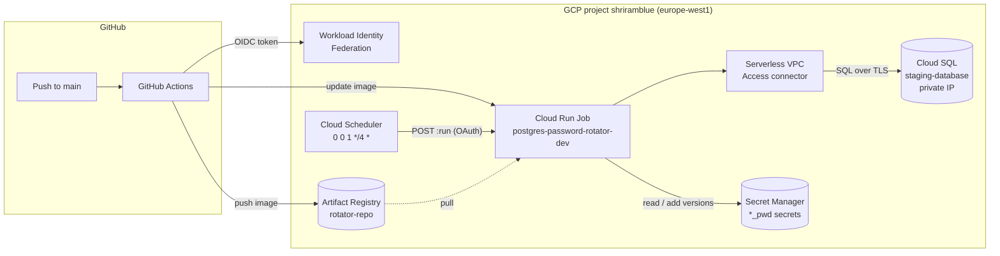

# Architecture

## Overview

The system is a **scheduled batch job**: it starts, rotates every configured
user's password, and exits. There is no long-running service, no database of
its own, and no inbound network traffic.

Three separate concerns, each owned by one part of the repo:

| Concern | Owner | How it changes |
| --- | --- | --- |
| Rotation logic | `rotator.py` (+ `Dockerfile`) | Push to `main` → GitHub Actions builds and deploys |
| GCP infrastructure | `terraform/` | `terraform apply`, run by hand |
| Delivery pipeline | `.github/workflows/deploy.yaml` | Push to `main` |



## Patterns

- **Infrastructure as Code.** Every GCP resource is in Terraform with remote
  state in GCS. The Cloud SQL instance and the secrets already existed and are
  only *looked up* (`data` sources), never managed, so Terraform can't delete
  them.
- **Configuration through environment variables.** Terraform injects
  everything the job needs; the image has no environment-specific values.
- **Keyless CI/CD.** GitHub Actions exchanges its OIDC token for short-lived
  GCP credentials. No service account keys exist anywhere.
- **Least privilege, one identity per role.** Separate service accounts for
  deploying, running the job, and triggering it (see
  [Identities](#identities-and-permissions)).
- **Immutable deploys.** CI deploys by image digest, not by tag. Terraform
  ignores the image field so it never rolls back a CI deploy.
- **Transactional rotation with compensation.** Each user's change is held in
  an open database transaction until the secret is written (see
  [Data flow](#data-flow)).

## Directory structure

```
.
├── rotator.py                  # The whole application: config, password
│                               #   generation, SQL, Secret Manager, logging
├── requirements.txt            # Pinned Python dependencies (scramp pinned
│                               #   explicitly for pg8000 compatibility)
├── Dockerfile                  # python:3.11-slim, non-root, ENTRYPOINT rotator.py
├── .github/workflows/
│   └── deploy.yaml             # Build → push → update Cloud Run Job on main
└── terraform/
    ├── main.tf                 # Backend, provider, and all resources, in
    │                           #   numbered sections (APIs, WIF, CI SA,
    │                           #   runtime SA + custom role, VPC connector,
    │                           #   Artifact Registry, Cloud Run Job, Scheduler)
    ├── variables.tf            # Inputs with dev defaults
    ├── terraform.tfvars        # Dev values (committed; no secrets)
    ├── outputs.tf              # WIF provider, SA emails, registry URL, ...
    └── .terraform.lock.hcl     # Provider version lock (committed)
```

### Inside `rotator.py`

The script is split into sections with no shared state except the `Config`
object, the DB connection and the `SecretStore`:

| Section | Responsibility |
| --- | --- |
| Logging | `JsonFormatter` writes one JSON object per line with `severity`, which Cloud Logging parses; `describe_error` scrubs secrets out of exception text |
| Configuration | `load_config()` validates env vars into a frozen `Config`; bad config exits with code 2 |
| Passwords | `generate_password()` (CSPRNG, all four character classes, no quotes or backslashes) and `scram_sha256_verifier()` |
| SQL helpers | `quote_ident` / `quote_literal`, needed because `ALTER USER` can't take bind parameters |
| Secret Manager | `SecretStore`: `read_latest()` and `add_version()` |
| Database | `connect()` with `build_ssl_context()` (`require` / `verify-ca` / `disable`) |
| Rotation | `rotate_user()`, plus `rotation_order()` and `main()` |

## Data flow

On each execution:

1. **Start-up.** `main()` loads config from the environment, reads the admin
   (`postgres`) password from its secret, and opens one TLS connection to
   `DB_PRIVATE_IP:5432` as `postgres`.
2. **Order.** Users are processed in `SECRET_MAPPINGS` order, with the admin
   user moved to the end.
3. **Per user** (`rotate_user`):

   ```mermaid
   sequenceDiagram
       participant R as rotator.py
       participant SM as Secret Manager
       participant DB as Cloud SQL
       R->>SM: access latest version (old password, kept in memory)
       R->>R: generate password + SCRAM-SHA-256 verifier
       R->>DB: ALTER USER ... WITH PASSWORD '<verifier>' (uncommitted)
       R->>SM: add version (new password)
       R->>DB: COMMIT
   ```

   - Secret write fails → the transaction is **rolled back**; DB and secret
     still both hold the old password.
   - `COMMIT` fails → the old password is **re-added** as the latest secret
     version, so the secret matches the DB again.
   - Both of those fail → logged at `CRITICAL`; needs manual repair.

   Only the SCRAM verifier, a salted hash, is sent to PostgreSQL. The plaintext
   password exists only in the job's memory and in Secret Manager, so it can't
   end up in PostgreSQL's logs.
4. **Exit.** Code `0` if every user succeeded, `1` if any failed (Cloud Run
   marks the execution failed), `2` for invalid config. One user's failure
   doesn't stop the others.

### Delivery flow

`push to main` → GitHub Actions authenticates through WIF as `sa-cicd-deployer`
→ `docker build` → push `rotator:<sha>` and `rotator:latest` →
`gcloud run jobs update --image=rotator@sha256:<digest>`.

## Identities and permissions

| Service account | Used by | Permissions |
| --- | --- | --- |
| `sa-cicd-deployer` | GitHub Actions through WIF (only `Sarank-tech/gcp-postgres-password-rotator`, branch `main`) | Run admin, Cloud Functions developer, Artifact Registry writer, Cloud Build editor, Scheduler admin, VPC Access user; object admin on the state bucket; `actAs` on `sa-db-rotator-dev` only |
| `sa-db-rotator-dev` | The Cloud Run Job | Custom role `CustomPostgresRotatorDev`: `secretmanager.secrets.get`, `secretmanager.versions.access`, `secretmanager.versions.add`, `cloudsql.instances.get`, `cloudsql.users.update` |
| `sa-rotator-scheduler-dev` | Cloud Scheduler | `roles/run.invoker` on this job only |

Notes:

- The custom role is bound **project-wide**, so the rotator can read and write
  every secret in the project, not just the four `*_pwd` secrets.
- The two `cloudsql.*` permissions aren't used: passwords change over SQL, not
  the Cloud SQL Admin API.
- Inside PostgreSQL the job connects as `postgres` (a member of
  `cloudsqlsuperuser`, not a true superuser). On PostgreSQL 16 it can only
  change passwords of roles it has `ADMIN OPTION` on.

## Infrastructure and network dependencies

| Dependency | Purpose | Managed by |
| --- | --- | --- |
| Cloud SQL `staging-database` | Target database; reached on private IP from `default` VPC; server only accepts encrypted connections | **Not** Terraform (data source only) |
| Secret Manager `*_pwd` secrets | Source of current and store of new passwords | **Not** Terraform (data source only) |
| Serverless VPC Access connector `pg-rotator-conn-dev` | Gives the job a path into `default` VPC (`10.8.0.0/28`, egress `PRIVATE_RANGES_ONLY`) | Terraform |
| Private Services Access on `default` VPC | Peering that gives Cloud SQL its private IP | Set up manually, outside Terraform |
| Artifact Registry `rotator-repo` | Image storage; keeps 10 newest, deletes others after 30 days | Terraform |
| Cloud Run Job | Runs the container (1 task, 600 s timeout, 1 retry) | Terraform (image: CI) |
| Cloud Scheduler | Calls `run.googleapis.com/v2/.../jobs/...:run` with an OAuth token | Terraform |
| Workload Identity Pool `github-actions-pool-dev` | Trusts `token.actions.githubusercontent.com` | Terraform |
| GCS bucket `shriramblue-tfstate-dev` | Terraform state (`postgres-password-rotator/dev`) | **Not** Terraform (pre-existing) |

Outbound calls from the job: Secret Manager API (public Google endpoint;
egress is private-ranges-only, so it doesn't go through the connector) and
Cloud SQL on its private IP (through the connector). Nothing calls into the
job except Cloud Scheduler, through the Cloud Run Admin API.

## Known limitations

- Rotations are only about every 120 days (cron can't do an exact day count).
- No dry-run mode and no automated tests.
- `DB_PRIVATE_IP` is set when Terraform applies; if the instance's private IP
  changes, re-run `terraform apply`.
- Applications that cache the password keep the old one until they re-read the
  secret, and the old password stops working right away. Consumers need to
  re-fetch the secret when authentication fails.
- Only `scramp` is pinned beyond the top-level dependencies; other indirect
  dependencies can still change between builds.
