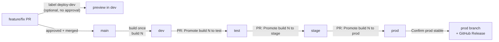

# CI/CD

How code gets from a pull request to every environment. For what the rotator
does and how it is built, see [ARCHITECTURE.md](ARCHITECTURE.md); for setup
commands, see [README.md](README.md).

## Model in one page

A hybrid of trunk-based development and per-environment control:

- **`main` is the only long-lived code branch.** Work happens on short-lived
  `feature/*` and `fix/*` branches, merged through reviewed PRs.
- **Try before you merge.** A PR can be deployed to dev as a throwaway
  preview, as often as needed, before anyone approves it. Only finished,
  approved work reaches `main`.
- **Build once.** Each merge to `main` builds one image (build number `N`)
  and deploys it to dev. That exact image (same digest) is what later goes to
  test, stage and prod. Nothing is rebuilt or copied.
- **One PR per environment.** Promoting build `N` to test (and later stage,
  prod) is its own PR, created with a button, reviewed and approved like any
  other. Merging it deploys the build.
- **`deploy/<env>.json` says what each environment runs**, so `main` always
  shows the state of every environment.
- **`prod` branch = the confirmed production copy.** After the prod sanity
  check, a button moves it to the released commit and creates a GitHub
  Release.



## Environments

| Env | GCP project | Gets a build by | Status |
| --- | --- | --- | --- |
| dev | `ingka-dp-sap-dev` | Every merge to `main` (automatic), or a PR preview | Live |
| test | `ingka-dp-sap-test` | Merging a "Promote build N to test" PR | Live |
| stage | _tbd_ | Merging a "Promote build N to stage" PR | Not set up |
| prod | _tbd_ | Merging a "Promote build N to prod" PR | Not set up |

Each environment has its own GCP project, Terraform state bucket
(`mdm-postgrespwd-tfstate-<env>`), Workload Identity pool, service accounts
and Cloud Run Job (`postgres-password-rotator-<env>`). Only dev has an
Artifact Registry (`rotator-repo`); the other environments run images from it.

## Day-to-day

### 1. Develop and try it in dev (PR preview)

1. Push your branch and open a PR to `main` as usual.
2. Add the label **`deploy-dev`**. Every push to the PR now builds a preview
   image and deploys it to dev. No approval is needed for this.
3. Run the dev job and test. Push fixes as often as needed.
4. Done testing: remove the label, or just merge. Dev goes back to `main`
   automatically. Closing the PR does the same.

Dev is shared: whoever deploys last wins. Agree in the team who holds the
`deploy-dev` label. **Actions → PR preview in dev → Run workflow** puts dev
back on the latest `main` build at any time ("Reset dev to main").

Previews are throwaway: they are stored as `pr-rotator`, can't be promoted,
and only the 5 newest are kept.

### 2. Merge

The PR needs an approval from a code owner (`.github/CODEOWNERS`) and a
passing **promotion-check**. Merging builds **build N** once and deploys it
to dev. The run summary shows the build number.

### 3. Promote to test (and later stage, prod)

1. **Actions → Create promotion PR → Run workflow**, from `main`.
2. Pick the environment. For test, leave *Build number* empty for the newest
   build in dev, or enter an earlier one. Stage and prod always get what the
   previous environment runs.
3. A PR opens, titled for example
   `Promote build 142 to test — Disable previous secret versions`. Its
   description shows the build, the image, what the environment runs now, the
   list of changes included, and a sanity checklist.
4. A code owner reviews and approves; you merge. The build is deployed to
   that environment within a minute or two.
5. Run the job there and tick off the checklist.

The order is enforced: test takes any build that reached dev, stage only the
build test runs, prod only the build stage runs. The only exception is a
rollback to a build the environment ran before.

### 4. Release to prod

After the prod sanity check, **Actions → Confirm prod stable → Run
workflow**. It checks prod really runs the build in `deploy/prod.json`, then:

- tags the image `prod-<date>-build-<n>` (kept forever),
- moves the `prod` branch to that commit,
- creates a GitHub Release (Releases page) listing the changes since the
  previous one.

## Common situations

**More changes while a build is in test or stage.** Fix forward: merge the
fix, which makes build N+1, then promote N+1 to test and on to stage. Test
and stage keep running their current build until the next promotion replaces
it; no rollback first.

**Drop a change that reached test or stage.** Two parts:

1. Take it out of the environment: create a promotion PR for the previous
   build (test: enter its build number; stage/prod: a build it ran before).
   The PR is marked as a rollback and lists the changes being removed.
2. Take it out of the code: revert its PR on `main` (GitHub's **Revert**
   button on the merged PR). Every later build is a snapshot of `main`, so
   until it's reverted, new builds still contain it.

**Disaster in prod.** Roll prod back with a promotion PR to an earlier
build prod ran (every prod release image is kept). Then run *Confirm prod
stable* with **Allow moving the prod branch back** ticked. Don't merge the
`prod` branch into `main`: that silently undoes everything merged since.

**Only a fix may go out, but `main` holds other unreleased work.** That is a
hotfix from a release branch, not covered yet. With PR previews, unfinished
work rarely reaches `main`, so it should be rare; add it if the team needs
it.

## Workflows

| File | Name in Actions | Runs on | Does |
| --- | --- | --- | --- |
| `build.yaml` | Build and deploy to dev | Merge to `main` (not `deploy/` or docs only), manual | Builds build N, deploys dev, tags `build-N`, `latest`, `deployed-dev` |
| `preview.yaml` | PR preview in dev | PR events with label `deploy-dev`; manual | Builds and deploys a PR preview; resets dev to `main` when done |
| `promote.yaml` | Create promotion PR | Manual (the button) | Opens the "Promote build N to env" PR, tags the image `candidate-…` |
| `promotion-check.yaml` | Promotion check | Every PR to `main` | Validates promotion PRs (other PRs pass at once); removes the candidate tag when a promotion PR is closed unmerged |
| `deploy.yaml` | Deploy promoted build | Merge changing `deploy/*.json` | Verifies and deploys the recorded image, moves `deployed-<env>` |
| `confirm-prod.yaml` | Confirm prod stable | Manual (the button) | Release tag, `prod` branch, GitHub Release |

`.github/scripts/promotion.sh` holds the shared settings: which environments
are enabled and their order.

## Images and retention

All images live in dev's Artifact Registry (`rotator-repo`):

| Image | Tags | Meaning |
| --- | --- | --- |
| `rotator` | `<commit sha>`, `build-<n>` | A build of `main`. `build-<n>` is added only after dev runs it |
| | `latest` | The newest build (what "Reset dev to main" deploys) |
| | `deployed-<env>` | What that environment runs now (moves on each deploy) |
| | `candidate-<env>-build-<n>` | An open promotion PR for this build |
| | `prod-<date>-build-<n>` | Released to prod (Confirm prod stable) |
| `pr-rotator` | `pr-<n>-<sha>` | A PR preview, never promotable |

The cleanup policy (about daily) keeps:

- the **10 newest** `rotator` builds and the **5 newest** previews,
- **anything tagged** `deployed-*`, `candidate-*` or `prod-*`, however old,

and deletes the rest. So the build prod runs, the builds waiting in test or
stage, open promotions and every prod release are never deleted, however many
builds dev makes in between. Only builds nobody uses rotate out.

## GitHub settings

### Environments (Settings → Environments)

| Setting | dev | test | stage / prod |
| --- | --- | --- | --- |
| `PROJECT_ID` | `ingka-dp-sap-dev` | `ingka-dp-sap-test` | that env's project |
| `REGION` | `europe-west1` | `europe-west1` | `europe-west1` |
| `WIF_PROVIDER` | `terraform output -raw wif_provider_name` | same, for test | same, for that env |
| `DEPLOY_SA` | `terraform output -raw cicd_service_account_email` | same, for test | same, for that env |
| Deployment branches | **No restriction** (PR previews run from PR branches) | `main` only | `main` only |
| Required reviewers | none | none (the promotion PR is the approval) | optional extra lock |

Use **Environment variables**, not secrets. These values are identifiers,
not credentials, and secrets would mask them in logs and block job outputs.

### Repository variables (Settings → Secrets and variables → Actions → Variables)

Used by the workflows that aren't tied to one environment:

| Variable | Value |
| --- | --- |
| `REGISTRY_REPO` | `europe-west1-docker.pkg.dev/ingka-dp-sap-dev/rotator-repo` |
| `REGISTRY_WIF_PROVIDER` | dev's `WIF_PROVIDER` |
| `REGISTRY_DEPLOY_SA` | dev's `DEPLOY_SA` |

### Repository settings

- **Settings → Actions → General → Workflow permissions**: tick **Allow
  GitHub Actions to create and approve pull requests** (the promotion button
  opens PRs).
- **Settings → General → Pull Requests**: tick **Automatically delete head
  branches** (removes `promote/*` branches after merge).
- Create the label **`deploy-dev`** (Issues → Labels). The promotion labels
  are created automatically.

### Branch protection

**`main`** (Settings → Branches, or Rules → Rulesets):

- Require a pull request before merging, 1 approval.
- **Require review from Code Owners**.
- Require status check **promotion-check** to pass.
- While setting the flow up you may allow admins to bypass; before go-live,
  tick **Do not allow bypassing the above settings**.

Promotion PRs are opened by `github-actions`, so anyone in the code owners
team can approve them, including the person who clicked the button. Your own
feature PRs need someone else's approval.

**`prod`**: block direct pushes, force pushes and deletion for everyone
except **GitHub Actions** (bypass list), so only *Confirm prod stable* moves
it. If GitHub Actions can't be added to the bypass list in your org, leave
`prod` unprotected but agreed as "only moved by the workflow".

## Authentication

There are no service account keys. Each environment's Terraform creates a
Workload Identity pool and provider that only accept GitHub OIDC tokens from
`ingka-group-digital/mdm-postgrespwd-rotator`, and:

- in **test, stage and prod**: only from `refs/heads/main`,
- in **dev**: also from pull request runs (`refs/pull/*`), for previews
  (`github_allow_pull_requests = true` in `envs/dev.tfvars`).

A PR, even one that edits a workflow, can therefore reach dev but never a
higher environment. PRs from forks get no credentials at all.

Workflows switch identities as needed: dev's (the registry: verify and tag
images) and the target environment's (deploy its job). `sa-cicd-deployer` in
each environment can only push or read images, update its own job and act
as its runtime service account.

## Infrastructure changes

CI deploys the application only. Terraform is run by hand, one environment at
a time, dev first:

```sh
cd terraform
terraform init -reconfigure -backend-config=envs/<env>.backend.hcl
terraform plan -var-file=envs/<env>.tfvars -out <env>.tfplan
terraform apply <env>.tfplan
```

On Windows PowerShell, quote the arguments:
`"-backend-config=envs/<env>.backend.hcl"`, `"-var-file=envs/<env>.tfvars"`.

- Always run `init` for the environment before its `plan`. A plan that wants
  to destroy resources of the other environment's project means the backend
  is pointing at the wrong state: don't apply it.
- `project_id` and `environment` have no defaults, so forgetting `-var-file`
  fails instead of silently targeting dev.
- A new environment's first apply has to be run locally: CI can't
  authenticate until that apply has created Workload Identity Federation.
- Planned: move Terraform into the pipeline (plan on PR, apply with approval)
  with its own service account, before stage and prod are set up.

## Adding stage and prod

1. Create the state bucket `mdm-postgrespwd-tfstate-<env>` (versioned,
   uniform access, public access prevention).
2. Add `terraform/envs/<env>.tfvars` (with `create_artifact_registry = false`)
   and `terraform/envs/<env>.backend.hcl`, and run the first apply.
3. Add the new project to `image_reader_projects` in `envs/dev.tfvars` and
   apply dev.
4. Create the GitHub Environment with its variables and `main`-only
   deployment branches.
5. Add the environment to `PROMOTION_ENVS` in `.github/scripts/promotion.sh`
   and to the `environment` choices in `promote.yaml`.

No other workflow changes are needed.

## Troubleshooting

| Symptom | Likely cause |
| --- | --- |
| `Variable X is not set` | GitHub Environment or repository variable missing, or added as a secret |
| Preview job doesn't start | Label isn't exactly `deploy-dev`, or the PR comes from a fork |
| Preview fails at authentication | Dev's Terraform not applied with `github_allow_pull_requests = true`, or dev's deployment branches restricted to `main` |
| Promotion button fails "create pull requests" | *Allow GitHub Actions to create and approve pull requests* not ticked |
| Promotion PR can't be merged, check pending | Re-run **Promotion check** on the PR's branch (Actions → Promotion check → Run workflow → branch `promote/...`) |
| `is not build N (missing, or cleaned up)` | The build was cleaned up before it was promoted; promote a newer one |
| `can only get the build <env> runs` | Stage/prod promotion of a build the previous environment doesn't run |
| Deploy fails with `artifactregistry.repositories.downloadArtifacts` denied | The environment's project missing from `image_reader_projects` in `envs/dev.tfvars`, or dev not applied since |
| Deploy succeeds but rotation fails | Not a pipeline problem: check the job's logs (Cloud SQL permissions, network path, secrets) |
