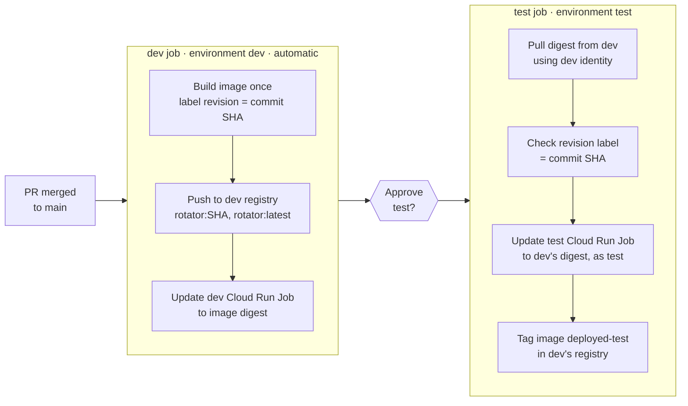

# CI/CD

How code gets from a pull request to every environment. For what the rotator
does and how it is built, see [ARCHITECTURE.md](ARCHITECTURE.md); for setup
commands, see [README.md](README.md).

## Model: trunk-based delivery

- `main` is the only long-lived branch. Work happens on short-lived
  `feature/*` and `fix/*` branches, merged through pull requests.
- Environments are **deployment targets, not branches**. There is no `dev`,
  `test`, `stage` or `prod` branch, and nothing is merged "up" between
  environments.
- **Build once, promote the artifact.** Each merge to `main` builds one image,
  stored once, in dev's Artifact Registry. Every later environment runs that
  exact image (same digest, same commit) straight from there, so what was
  tested is what reaches production.
- Hotfixes follow the same path as any other change: `fix/*` → PR → `main`
  → promote. Nothing has to be merged back anywhere.

| Traditional branch-per-environment | This repository |
| --- | --- |
| One branch per environment | `main` plus short-lived branches |
| Promote by merging branches | Promote by deploying the same image |
| Each environment builds its own image | One image, one registry, deployed by digest |
| Hotfixes merged back into every branch | Nothing to merge back |

## Environments

| Env | GCP project | Gate | Status |
| --- | --- | --- | --- |
| dev | `ingka-dp-sap-dev` | Automatic on every merge to `main` | Live |
| test | `ingka-dp-sap-test` | One approval click (required reviewers) | Being set up |
| stage | _tbd_ | Approval required | Not set up |
| prod | _tbd_ | Approval required | Not set up |

Each environment has its own GCP project, Terraform state bucket
(`mdm-postgrespwd-tfstate-<env>`), Workload Identity pool, service accounts
and Cloud Run Job (`postgres-password-rotator-<env>`). Only dev has an
Artifact Registry (`rotator-repo`); the other environments run images from it.

## Pipeline

`.github/workflows/deploy.yaml` runs on every push to `main` and on manual
dispatch.



### dev job

1. Checks the `dev` environment variables are set.
2. Authenticates to `ingka-dp-sap-dev` through Workload Identity Federation.
3. Builds the image with the label
   `org.opencontainers.image.revision=<commit SHA>`.
4. Pushes `rotator:<SHA>` and `rotator:latest` to dev's Artifact Registry.
5. Points dev's Cloud Run Job at the pushed **digest**, never at a tag, so
   what runs can't change underneath it.
6. Exposes the digest and dev's WIF identity to the next job.

### test job

1. Waits for a required reviewer on the `test` GitHub Environment.
2. Authenticates **as dev** and pulls the exact digest dev deployed.
3. Fails if the image's revision label isn't this run's commit SHA.
4. Authenticates **as test** and points test's Cloud Run Job at that digest in
   dev's registry. Test's Cloud Run service agent and test's deployer both
   have read access to dev's registry (granted by dev's Terraform,
   `image_reader_projects`).
5. Authenticates **as dev** again and tags the image `deployed-test`, so dev's
   cleanup policy keeps it while test runs it. The tag moves with each
   promotion.

Nothing is rebuilt or copied: there is one image, in one registry.

### Concurrency

Each environment has its own concurrency group (`deploy-dev`, `deploy-test`),
so two deploys never hit the same environment at once. When several runs are
waiting for test approval, a newer run's pending test deploy replaces the
older one, so approving always promotes the latest `main`.

Deploys don't run the job. Rotations happen on the Cloud Scheduler schedule
(quarterly) or when someone executes the job.

## GitHub Environments

Configured under repository Settings → Environments. The workflow reads all
environment-specific values from here; nothing per-environment is hard-coded.

| Setting | dev | test | stage / prod |
| --- | --- | --- | --- |
| `PROJECT_ID` | `ingka-dp-sap-dev` | `ingka-dp-sap-test` | that env's project |
| `REGION` | `europe-west1` | `europe-west1` | `europe-west1` |
| `WIF_PROVIDER` | `terraform output -raw wif_provider_name` | same, for test | same, for that env |
| `DEPLOY_SA` | `terraform output -raw cicd_service_account_email` | same, for test | same, for that env |
| Deployment branches | `main` only | `main` only | `main` only |
| Required reviewers | none | dev team | stricter reviewer group |

Environments must exist, with their variables, **before** a workflow that
uses them runs. Otherwise GitHub creates an empty, unprotected environment and
the job fails its variable check.

A pending approval waits up to 30 days, then the job is cancelled.

## Authentication

There are no service account keys. Each environment's Terraform creates a
Workload Identity pool and provider (`github-actions-pool-<env>`,
`github-provider-<env>`) that only accepts GitHub OIDC tokens where:

- `repository` is `ingka-group-digital/mdm-postgrespwd-rotator`, and
- `ref` is `refs/heads/main`.

A workflow edited on a feature branch therefore can't deploy anywhere. Tokens
are exchanged for that environment's `sa-cicd-deployer`, which can push
images, update the Cloud Run Job and act as the job's runtime service account,
and nothing broader.

The test job switches identities: dev's (verify the image), test's (deploy),
then dev's again (tag the image). Each later environment follows the same
pattern.

## Infrastructure changes

CI deploys the application only. Terraform is run by hand, one environment at
a time, in the same order as the application (dev first):

```sh
cd terraform
terraform init -reconfigure -backend-config=envs/<env>.backend.hcl
terraform plan -var-file=envs/<env>.tfvars -out <env>.tfplan
terraform apply <env>.tfplan
```

- The code is the same for every environment. Only `envs/<env>.tfvars` and
  `envs/<env>.backend.hcl` differ.
- `project_id` and `environment` have no defaults, so forgetting `-var-file`
  fails instead of silently targeting dev.
- Always use `-reconfigure` when switching environments in one checkout, and
  answer **no** if Terraform offers to copy state between backends.
- A new environment's first apply has to be run locally: CI can't
  authenticate until that apply has created Workload Identity Federation.

## Image retention

Dev's Artifact Registry is the only registry. Its cleanup policy (runs about
daily) keeps:

- the **3 newest** image versions, and
- every image tagged `deployed-<env>`, i.e. what each later environment
  currently runs,

and deletes the rest. Consequences:

- Dev can roll back about two deploys. Other environments roll back by
  promoting again (or by pointing at one of the 3 newest).
- If more than three merges land before someone approves test, dev may have
  already deleted the image the old run would promote. That test job fails at
  the pull; approve a newer run instead.

## Rollback

**Preferred: roll forward.** Revert the bad commit on a branch, merge it, and
promote as usual.

**Fast, one environment:** point the job back at an earlier digest still in
dev's registry:

```sh
gcloud artifacts docker images list \
  europe-west1-docker.pkg.dev/ingka-dp-sap-dev/rotator-repo/rotator --include-tags
gcloud run jobs update postgres-password-rotator-<env> \
  --image=europe-west1-docker.pkg.dev/ingka-dp-sap-dev/rotator-repo/rotator@sha256:<digest> \
  --region=europe-west1 --project=<project>
```

For an environment other than dev, also move its tag so cleanup keeps that
image: `gcloud artifacts docker tags add <image>@sha256:<digest> <image>:deployed-<env>`.

The next promotion to that environment replaces it again, so follow up with a
revert on `main`.

**Re-run an older workflow run:** re-running an older successful run from the
Actions tab redeploys that commit. Its dev job rebuilds the image from that
commit (a new digest), and the test job re-promotes it after approval.

## Adding stage and prod

1. Create the state bucket `mdm-postgrespwd-tfstate-<env>` (versioned,
   uniform access, public access prevention).
2. Add `terraform/envs/<env>.tfvars` (with `create_artifact_registry = false`)
   and `terraform/envs/<env>.backend.hcl`.
3. Run the first Terraform apply locally (see Infrastructure changes).
4. Add the new project (`"<project-id>" = "<project-number>"`) to
   `image_reader_projects` in `envs/dev.tfvars` and apply dev, after the new
   environment's apply (its `sa-cicd-deployer` must exist).
5. Create the GitHub Environment with its variables, `main`-only deployment
   branches and required reviewers.
6. Add a `<env>` job to `deploy.yaml`, copied from the `test` job, with
   `needs:` set to the previous environment and `DEPLOYED_TAG: deployed-<env>`.
   It still verifies and tags through dev's identity (`needs.dev.outputs`).

## Troubleshooting

| Symptom | Likely cause |
| --- | --- |
| `Variable X is not set on the <env> environment` | GitHub Environment missing or a variable not added |
| Auth step fails with `unauthorized_client` / `permission denied` | Wrong `WIF_PROVIDER`/`DEPLOY_SA`, workflow not running from `main`, or repository name changed without updating `github_repository` in tfvars |
| Test job fails pulling the image | Dev's cleanup removed that digest; approve a newer run |
| Test job update fails with `artifactregistry.repositories.downloadArtifacts` denied | Test's project missing from `image_reader_projects` in `envs/dev.tfvars`, or dev not applied since |
| `Image revision ... does not match commit` | Dev's output points at an image built from another commit; re-run the whole workflow |
| Deploy succeeds but rotation fails to connect | Not a pipeline problem: check the job's logs (Cloud SQL permissions, network path, instance SSL mode) |
